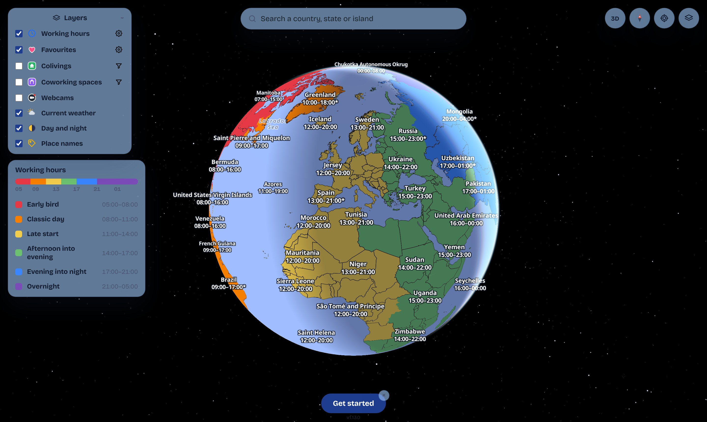
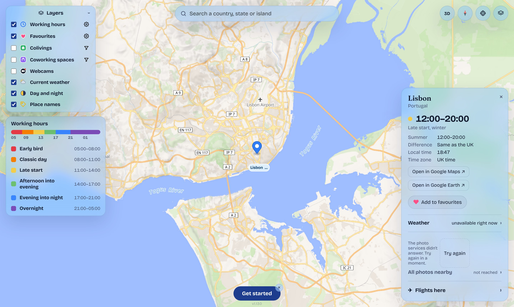
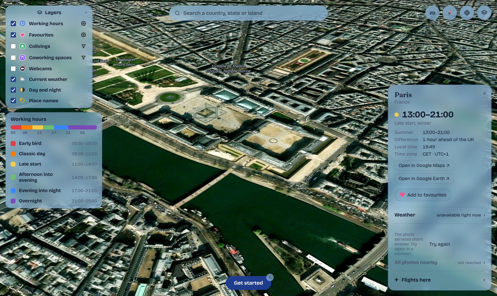
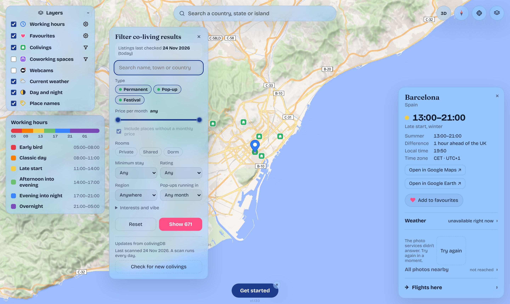
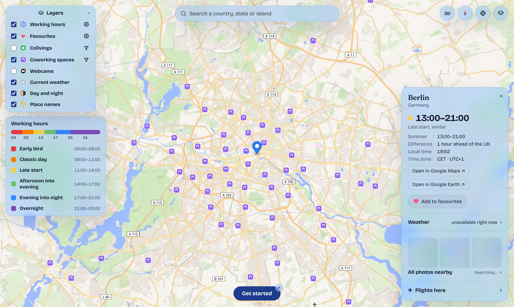
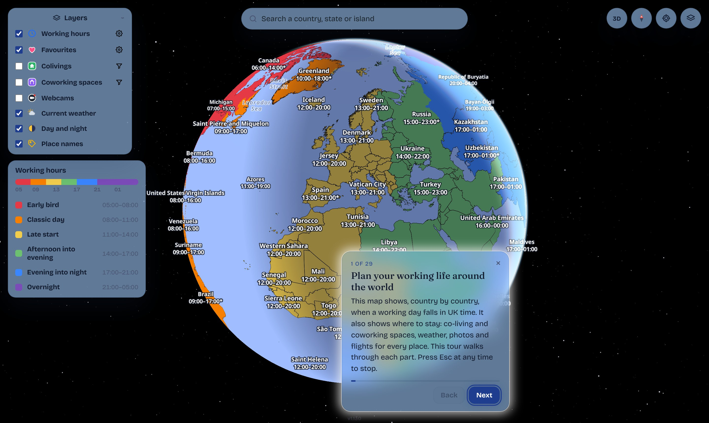

# Working Hours Globe

**Plan your working life around the world.** Set your shift in UK time, then spin a 3D globe and see, country by country and city by city, when your working day falls in local time. Then find where to stay: co-living and coworking spaces, weather, photos and flights for every place, in one place.

**[Open the live site →](https://granterogers.github.io/working_hours_globe/)** &nbsp;·&nbsp; [Full feature list](docs/FEATURES.md)



---

## Why it saves time

Working across time zones means doing the same sums again and again: what time is it there, is that still a sensible hour to call, and is the place I'm looking at any good to work from? Working Hours Globe answers those questions at a glance.

- **Know the answer before you ask.** Every country is coloured by how your shift lands locally. Hover, click or zoom and the local hours, the time difference and the local clock are on screen.
- **Compare places without a spreadsheet.** Click any spot for its hours in winter and summer, its offset from the UK, and its time zone.
- **Plan a whole trip in one place.** Search a city, then add it to favourites, check the weather, read the nearby photos, see co-living and coworking options, and open the route in Google Maps or Google Earth.
- **Works everywhere.** The same app runs in a browser on a laptop or a phone, with no install and nothing to sign up for.

## See it in action

| | |
|---|---|
|  | **Place cards that answer the question.** Local time, the working-hours band, the time difference from the UK, and Open in Google Maps or Google Earth in one tap. |
|  | **3D, when you want the detail.** Tilt into real terrain over any base map, from satellite to street, with your working-hours colours kept on top. |
|  | **Find the right co-living.** Filter by type, price, rooms, minimum stay, rating, region, pop-up dates, and interests and vibe. Your filters are remembered. |
|  | **Coworking, mapped.** Purple desks for coworking spaces from open data, thinned out when you zoom out so the busy areas show first. |
|  | **A guided tour of the whole app.** Press *Get started* and a cursor walks you through every control, with a ring on what it's talking about. Esc stops it at any time. |

## What's inside

- **Working hours on every country,** colours from real time-zone boundaries, with a shift you set in UK time and winter or summer switching.
- **Street detail when you zoom in:** English place names, roads and points of interest from OpenStreetMap.
- **Day and night** on the globe and in 3D.
- **Weather** for places on the map and in every card, with a 7-day forecast.
- **Photos nearby** from open sources, with credits and licences shown.
- **Flights:** search Google Flights or Skyscanner with your airport and dates filled in.
- **Favourites** you can drag, annotate and keep between visits.
- **Your own layers:** add KML, KMZ or GeoJSON files and click through them with your hours alongside.
- **Featured listings:** paid placements appear in a panel bottom left, only when they are actually in view and clearly marked.
- **Dark and light themes,** full-screen mode, keyboard controls and a layout for phones.

## Quick start

The site is static: there is no server to run and no build step.

- **Use it:** [granterogers.github.io/working_hours_globe](https://granterogers.github.io/working_hours_globe/)
- **Run it locally:** serve the folder (browsers won't load the data files from a double-clicked `index.html`):
  ```bash
  cd working_hours_globe
  python3 -m http.server 8000
  ```
  Then open <http://localhost:8000>.

## Deploy your own copy

1. Fork or push this repository to your GitHub account.
2. In **Settings → Pages**, choose **Deploy from a branch**, then `main` and `/ (root)`.
3. The site appears at `https://<your-user>.github.io/<repo>/` within a minute or two.

Everything the site needs is in the repository (`.nojekyll` tells GitHub Pages to serve the files as they are).

## Keeping the data fresh

Several data sets refresh themselves on a schedule with GitHub Actions:

| Data | Refreshed by | When |
|---|---|---|
| Co-living listings (colivingDB) | `scripts/coliving.py` | every morning |
| Coworking spaces (Overture Maps, OpenStreetMap) | `scripts/coworking.py` | weekly |
| Webcams | `scripts/webcams.py` | weekly |
| Weather stations (METAR) | `scripts/metar.py` | every three hours |
| Guided tour check | `tests/tour.js` in a real browser | every push and nightly |

The co-living panel shows the date it was last checked, so you can always see how current the list is.

## Project layout

```
index.html                 the page
assets/app.js              the globe, 3D view, layers, search and cards
assets/tour.js             the guided tour
assets/style.css           styles and themes
data/                      prebuilt data (time zones, listings, weather, featured entries)
scripts/                   the refresh and build scripts (Python, standard library where possible)
tests/                     browser tests (Playwright) and the review prompt for Claude Cowork
docs/                      full feature list and screenshots
```

## Tests

```bash
npm install playwright && npx playwright install chromium
BASE=http://127.0.0.1:8000/ node tests/visual.js
BASE=http://127.0.0.1:8000/ node tests/tour.js
```

`tests/visual.js` checks the globe and labels. `tests/tour.js` walks all 29 steps of the guided tour and checks each one lands on its target and puts the view back when it ends.

## Data and credits

- Map tiles and vector data: [OpenFreeMap](https://openfreemap.org/) and [OpenStreetMap](https://www.openstreetmap.org/copyright) contributors.
- Satellite imagery: Esri World Imagery. Topographic: OpenTopoMap. Terrain: [Mapterhorn](https://mapterhorn.com/).
- Time zones: IANA tz database. Country borders: [Natural Earth](https://www.naturalearthdata.com/).
- Co-living listings: [colivingDB](https://colivingdb.com). Coworking: [Overture Maps](https://overturemaps.org/) and OpenStreetMap. Webcams: [Windy](https://www.windy.com/webcams).
- Weather: [Open-Meteo](https://open-meteo.com/) and [AviationWeather.gov](https://aviationweather.gov/).
- Photos: Wikimedia Commons, Wikidata, Panoramax, KartaView and OpenStreetMap, each credited on the photo.
- Built with [MapLibre GL JS](https://maplibre.org/), [D3](https://d3js.org/) and [JSZip](https://stuk.github.io/jszip/).

See [`data/LICENSE-DATA.md`](data/LICENSE-DATA.md) for the licence of each data set.

## Contributing

Issues and pull requests are welcome. For changes to the guided tour, edit the steps in `assets/tour.js`; the tour drives the real controls, so it follows interface changes automatically.

## Licence

See [LICENSE](LICENSE).
